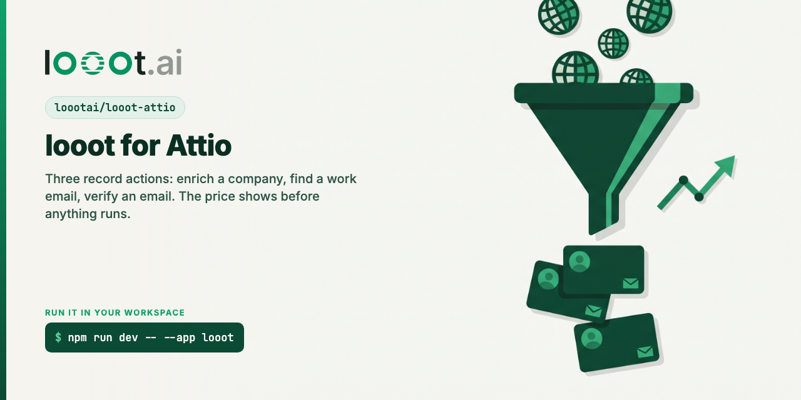

# looot-attio

[](LICENSE) [](https://docs.looot.ai)

An [Attio](https://attio.com) App SDK app for [looot](https://looot.ai). looot gives a workspace one key
and one prepaid balance for 2,500+ data endpoints from 90+ providers. This app puts three of its jobs
on people and company records as record actions.

Status: source only. Not installed in an Attio workspace and not in the Attio App Store. It typechecks,
lints, passes 55 tests and `attio build` succeeds, but no action has been clicked inside Attio. See
"Not tested on the live platform".

## What it adds

| Record action             | On        | looot job             | Writes to                              | Price                     |
| ------------------------- | --------- | --------------------- | -------------------------------------- | ------------------------- |
| Enrich company with looot | companies | `company.enrich`      | `looot_industry`, `looot_company_size` | from $0.0019 per lookup   |
| Find work email           | people    | `people.email.find`   | `email_addresses`                      | from $0.003598 per lookup |
| Verify email              | people    | `people.email.verify` | `looot_email_status`                   | from $0.00145 per lookup  |

Prices are the cheapest provider of each job in the public catalog
(`GET https://api.looot.ai/v1/catalog/overview?depth=jobs`) on 2026-10-09. They change. The app does
not hardcode them: it reads the same URL each time and uses these three numbers only when that read
fails, and says so in the confirmation.

Record actions show on the record page and in the Cmd+K palette.

### What happens on a click

1. The app reads the record through Attio's REST API and the price through looot's public catalog.
   Nothing is charged for this step.
2. If there is nothing to do, it says why and stops. A person who already has an email is not looked
   up again. A company with both attributes filled is not enriched again.
3. Otherwise it asks to confirm, with the record, the price and the cap:
   "Look up the work email of Ada Lovelace at example.com. One lookup costs from $0.0036 (cheapest
   provider in the looot catalog right now) and never more than $0.05. It is paid from your looot
   balance. A lookup that fails costs nothing."
4. On "Run lookup" it runs one looot job and writes the result to the record. A toast shows what was
   written and what was charged.

### What each action reads and writes

- **Find work email** sends the person's first name, last name, full name, LinkedIn URL, and the
  domain and name of the linked company. It adds the email looot finds to `email_addresses` with a
  PATCH, which appends and never removes an address.
- **Verify email** sends the person's first email address. It saves the status the provider returned
  (or `deliverable` / `undeliverable`) in a text attribute, "Email status (looot)". A second
  verification replaces the first result.
- **Enrich company with looot** sends the company's first domain and its name. It fills "Industry
  (looot)" and "Company size (looot)". It fills empty attributes only and never overwrites a value.

The three `looot_*` attributes are text attributes the app creates the first time they are needed.
They are created before the paid call, so a missing permission stops the action before any charge.

### How a lookup is sent

Every lookup is `POST https://api.looot.ai/v1/runs` with `endpointId` set to `job:<job id>`,
`wait: 20` and `fallback: { enabled: true, maxCostUsd: 0.05 }`. looot tries the next provider of the
same job when the first finds nothing and charges only the attempts that ran, never more than $0.05
for one lookup. The idempotency key is `attio-` plus the SHA-256 of the job, the input and the UTC
date: the same lookup twice in one day replays the first run and pays once.

Attio stops a server function after 30 seconds. If looot has not finished after 20, the toast says
the run is still working and to run the action again in a minute. The second click replays the same
run, so it is not charged twice.

Values come from looot's [normalized output](https://docs.looot.ai/concepts/normalized-output). When
the provider that answered has no field map, the action reports "not found".

## Settings

There is one setting, and it is not in this repo: the looot token.

| What        | Where                                                                                           | Value                                                                    |
| ----------- | ----------------------------------------------------------------------------------------------- | ------------------------------------------------------------------------ |
| looot token | Developer console, your app, Connections tab: add a **workspace** connection of type **Secret** | Each workspace's admin pastes a looot agent token when Attio asks for it |
| Scopes      | Developer console, your app, scopes                                                             | `record_permission:read-write`, `object_configuration:read-write`        |

The token is created in the looot dashboard under Settings, Agent tokens, with `catalog.read`,
`runs.read`, `runs.execute` and `usage.read`. The server functions read it with
`getWorkspaceConnection().value`. It never reaches client code, is never logged and is never returned
to the browser. When a workspace has no token yet, Attio shows its own prompt to add one. Only
workspace admins can set a workspace connection.

Why each scope: reading a person or a company needs `record_permission:read` and
`object_configuration:read`; writing the result needs `record_permission:read-write`; creating the
three text attributes needs `object_configuration:read-write`.

## Layout

```text
src/
├── app/extensions/
│   ├── enrich-company/extension.tsx     record action on companies
│   ├── find-work-email/extension.tsx    record action on people
│   └── verify-email/extension.tsx       record action on people
├── server/
│   ├── prepare-lookup.server.ts         reads the record and the price
│   └── run-lookup.server.ts             runs the lookup and writes the result
└── lib/
    ├── record-action.ts                 prepare, confirm, run, toast
    ├── actions.ts                       the three lookups, start to end
    ├── attio-records.ts                 Attio REST: get, patch, create attribute
    ├── looot.ts                         looot REST: run a job
    ├── prices.ts                        the "from" price from the public catalog
    └── sha256.ts                        SHA-256 without a crypto module
```

Attio's server runtime is not Node.js and its documented globals have no crypto module, so the
idempotency key uses a small SHA-256 in plain TypeScript. A test checks it against `node:crypto`.

## Develop and test

Needs Node 20 or newer.

```bash
npm ci --ignore-scripts
npm run typecheck
npm run lint
npm test
npm run build
```

Output on 2026-10-09, Node 24.18.0, attio 1.1.2:

```
> tsc --noEmit -p tsconfig.json && tsc --noEmit -p tsconfig.test.json        (npm run typecheck, no errors)
All matched files use Prettier code style!                                   (npm run lint, eslint 0 problems)
 Test Files  4 passed (4)
      Tests  55 passed (55)                                                  (npm test)
✓ GraphQL types generated successfully
✓ TypeScript validation passed
✓ JavaScript build completed successfully                                    (npm run build)
```

`attio build` runs on a laptop with no Attio login. It wrote `dist/index.js` with the three record
actions and `dist/server.js` with the two server functions. No test calls looot or Attio, so no test
spends credit. Every dependency is pinned to an exact version that was at least 7 days old on
2026-10-09, which is why `attio` is 1.1.2 and not 1.1.3 (published 2026-10-06).

## Not tested on the live platform

The app has never run inside Attio. `attio dev` needs an Attio login and a developer account, and
neither was used. Check these first, in this order:

1. `npm run dev -- --app <your app slug>` uploads the app and the three actions show on a person and
   on a company.
2. The workspace connection prompt appears on the first click and accepts a looot token.
3. `GET /v2/objects/people/records/{id}` returns `name[0].first_name`, `email_addresses[0].email_address`,
   `linkedin[0].value` and `company[0].target_record_id` the way `src/lib/actions.ts` reads them, and
   the company record returns `domains[0].domain` and `name[0].value`. The shapes come from Attio's
   attribute type pages, not from a real response.
4. `POST /v2/objects/{object}/attributes` creates the three text attributes with the app's token and
   answers 409 on the second call. The tests assume 409 for "already exists", from the endpoint page.
5. `PATCH /v2/objects/people/records/{id}` with `{ "data": { "values": { "email_addresses": ["..."] } } }`
   adds the address.
6. `confirm()` and `showToast()` render the texts as written. The loading toast is asked to stay 30
   seconds and is hidden when the result arrives.
7. One real lookup of each kind with your own looot token, about $0.007 for all three.

Also not verified: whether the error message of a failed server function reaches the client
unchanged (the code avoids relying on it by returning errors as data), and whether Attio's own
enrichment hides or locks any attribute read here on some plans (its docs say enriched attributes can
be hidden from the API depending on the billing plan).

Not built: a bulk action for many records at once, a workflow block, and a per-workspace setting for
the cost cap. The cap is the constant `MAX_COST_PER_LOOKUP_USD` in `src/lib/looot.ts`.

## Ship it

These steps need an Attio account, so they are yours.

1. Sign in at https://build.attio.com, create a developer account named `looot`, add its logo.
2. Create an app. Name `looot`, slug for example `looot`. Attio's listing rules say the app name
   must not contain "Attio".
3. In the app's settings: Connections tab, add a workspace connection of type Secret. Then grant the
   two scopes listed under Settings above.
4. Run it in a development workspace (Attio recommends one that is not your production workspace):

   ```bash
   git clone https://github.com/loootai/looot-attio && cd looot-attio
   npm ci --ignore-scripts
   npx attio login
   npm run dev -- --app looot
   ```

5. Go through the list in "Not tested on the live platform".
6. Share it before review: `npx attio version create --app looot`, then in the Developer console open
   the app's overflow menu, "Share privately", and send the link. Installers see a warning that the
   app is not reviewed.
7. Publish: "Publish app" in the Developer console. Attio reviews the listing, the logos, the images
   and this code, and aims to finish within 1 week. The first submission needs a screen recording
   that shows install, the connection and each action. Draft listing text is in
   [docs/listing.md](docs/listing.md).

Attio's code review rules that shaped this code: no secret in client code, no PII in logs (the
source has no `console` call, a test enforces it), every external call authenticated, no deprecated
SDK API (the app uses the folder layout, not `app.ts`).

## Docs read

All on 2026-10-09:

- https://docs.attio.com/sdk/guides/creating-an-app
- https://docs.attio.com/sdk/extensions/overview and https://docs.attio.com/sdk/extensions/record-action
- https://docs.attio.com/sdk/guides/authenticating-to-external-services and https://docs.attio.com/sdk/server/connections/get-workspace-connection
- https://docs.attio.com/sdk/server/server-functions, https://docs.attio.com/sdk/server/available-globals and https://docs.attio.com/sdk/server/attio-api-token
- https://docs.attio.com/sdk/notifications/confirm and https://docs.attio.com/sdk/notifications/show-toast
- https://docs.attio.com/rest-api/endpoint-reference/records/get-a-record
- https://docs.attio.com/rest-api/endpoint-reference/records/update-a-record-append-multiselect-values
- https://docs.attio.com/rest-api/endpoint-reference/attributes/create-an-attribute
- https://docs.attio.com/docs/standard-objects/standard-objects-people and https://docs.attio.com/docs/standard-objects/standard-objects-companies
- https://docs.attio.com/share/the-publication-lifecycle, https://docs.attio.com/share/private-invites, https://docs.attio.com/share/publishing-to-the-app-store, https://docs.attio.com/share/app-listings and https://docs.attio.com/share/code-review

The scaffold files (`tsconfig.json`, `eslint.config.js`, `.prettierrc`) come from the template inside
the `attio` 1.1.2 npm package, the one `npm create attio` writes.

## Related

- [twenty-app-looot](https://github.com/loootai/twenty-app-looot) and [looot-hubspot](https://github.com/loootai/looot-hubspot): the same three lookups on other CRMs.
- [looot-instantly](https://github.com/loootai/looot-instantly): find and verify work emails, then load them into an Instantly campaign.
- [looot-zapier](https://github.com/loootai/looot-zapier), [looot-make](https://github.com/loootai/looot-make), [n8n-nodes-looot](https://github.com/loootai/n8n-nodes-looot): looot on automation tools.
- [looot-mcp](https://github.com/loootai/looot-mcp): the remote MCP server, `claude mcp add --transport http looot https://api.looot.ai/mcp`.
- [awesome-gtm](https://github.com/loootai/awesome-gtm): open-source GTM tools.

MIT, copyright looot.
